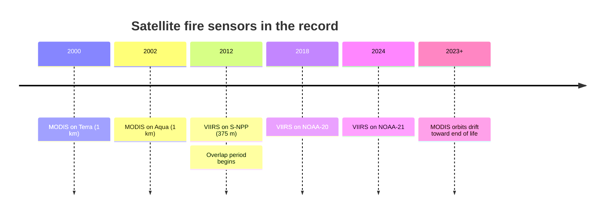
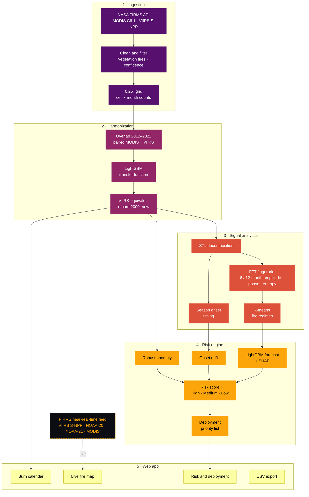
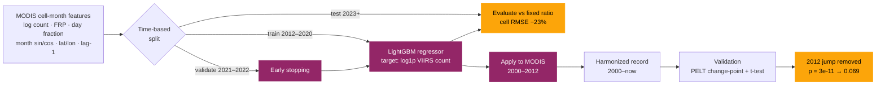
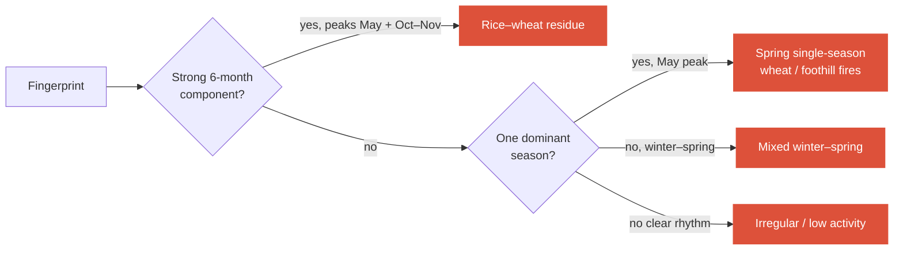
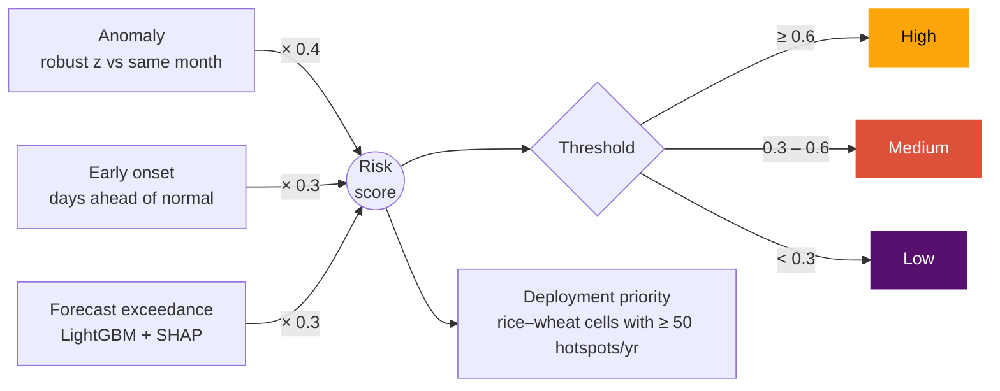
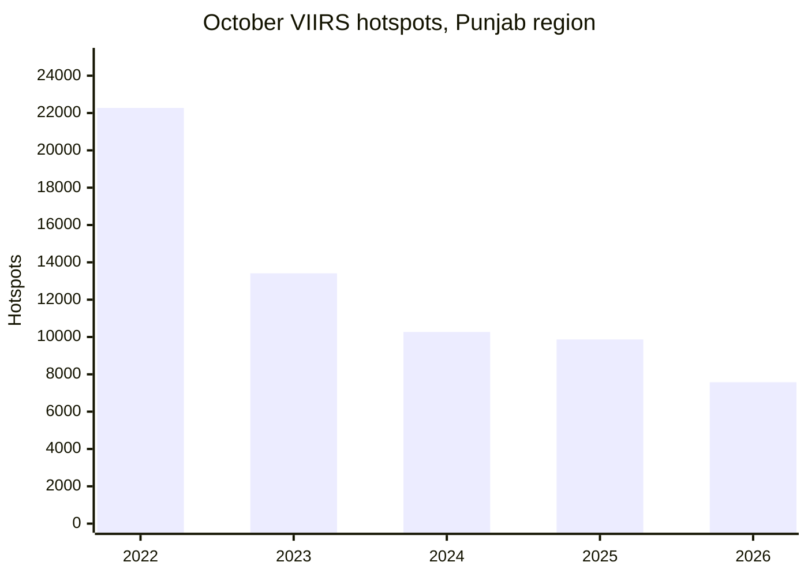
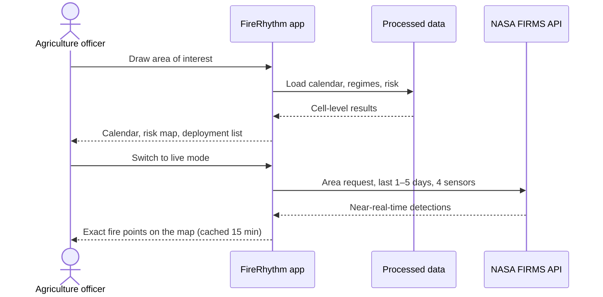
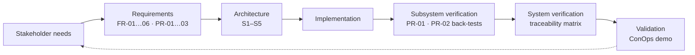

<div align="center">

# FireRhythm

### One consistent fire record from two satellite generations

Harmonized NASA MODIS + VIIRS hotspots reveal the rhythm of burning across the Punjab rice–wheat belt,
flag unusual activity, and tell agriculture teams where crop-residue burning will peak next.

[](https://firerhythm-a5uhhgdifiotpkmfmklsvy.streamlit.app)
[](https://www.spaceappschallenge.org)
[](https://firms.modaps.eosdis.nasa.gov)
[](https://www.python.org)
[](#license)

**Challenge:** Harmonization of MODIS and VIIRS Hot Spots

[Live app](https://firerhythm-a5uhhgdifiotpkmfmklsvy.streamlit.app) · [Demo video](#) · [Slides](#) · [Systems engineering pack](docs/systems_engineering.md)

</div>

---

## Contents
1. [The problem](#the-problem)
2. [Study area](#study-area)
3. [System overview](#system-overview)
4. [AI / ML harmonization](#ai--ml-harmonization)
5. [Signal fingerprints](#signal-fingerprints)
6. [Risk engine and early warning](#risk-engine-and-early-warning)
7. [Key results](#key-results)
8. [The web app](#the-web-app)
9. [Run it yourself](#run-it-yourself)
10. [Systems engineering](#systems-engineering)
11. [Limitations and roadmap](#limitations-and-roadmap)

---

## The problem

MODIS has observed fires since 2000 at 1 km resolution. VIIRS, its successor, sees at 375 m and detects
**3–8 times more hotspots** over the same fires. Splicing the two records creates a fake jump in fire activity in 2012,
so fire managers have no consistent picture of when and where burning has happened.



> [!IMPORTANT]
> Without harmonization, the naive MODIS → VIIRS splice shows a statistically certain jump at the 2012 sensor switch
> (**p = 3 × 10⁻¹¹**). That jump is an artifact of the sensors, not a real change in burning.

---

## Study area

The Punjab rice–wheat belt across Pakistan and India (69–78° E, 27–33° N), analysed on a 0.25° grid of 648 cells.
GitHub renders this map interactively; you can pan and zoom it.

```geojson
{
  "type": "FeatureCollection",
  "features": [
    {
      "type": "Feature",
      "properties": { "name": "FireRhythm study area", "grid": "0.25 degree, 648 cells" },
      "geometry": { "type": "Polygon", "coordinates": [[[69, 27], [78, 27], [78, 33], [69, 33], [69, 27]]] }
    }
  ]
}
```

---

## System overview



---

## AI / ML harmonization

We treat each sensor as a measuring system that filters the true fire signal. MODIS's coarse pixels act like a
**low-pass, under-sampling filter** that misses small burns. Using the years when both sensors were observing, we
**identify the transfer function** from MODIS to VIIRS with gradient boosting, then apply it to the MODIS-only years.



<details>
<summary><b>Why a learned model instead of a fixed conversion factor?</b></summary>

A fixed VIIRS/MODIS ratio per calendar month reached R² = 0.84 on 2021+ but dropped to **0.54 on 2023+**, as the Terra
and Aqua orbits drifted and MODIS detections weakened. The learned transfer function held up at **R² = 0.73** (cell level)
and **0.83** (regional), because it uses fire intensity (FRP), day/night mix and local context, not a single number.

</details>

---

## Signal fingerprints

Every cell's harmonized monthly series is treated as a signal:

| Step | Method | Output |
| --- | --- | --- |
| Decompose | STL (period 12, robust) | trend, seasonal, residual |
| Spectrum | Hann-windowed FFT of the detrended signal | amplitude at 12 and 6 months, dominant period, spectral entropy |
| Timing | 10th / 50th percentile of each season's detections | onset and midpoint of rice and wheat burning |
| Regimes | k-means on the fingerprint (k chosen by silhouette) | burning regimes, **discovered without a land-cover map** |



The rice–wheat regime has a median burning onset of about **19 October** and a midpoint of about **2 November**,
which matches the known stubble-burning season.

---

## Risk engine and early warning

$$
z = \frac{x - \operatorname{median}_{\text{same month, past years}}}{1.4826 \cdot \operatorname{MAD}}
\qquad
\text{risk} = 0.4\,\tilde{z} + 0.3\,\tilde{d}_{\text{early}} + 0.3\,\tilde{e}_{\text{forecast}}
$$

where the tilde marks values min–max normalised across cells, $d_{\text{early}}$ is how many days the season started
ahead of normal, and $e_{\text{forecast}}$ is next month's forecast divided by the usual level.



---

## Key results

| Test | Result |
| --- | --- |
| Harmonization vs fixed ratio (test 2023+) | Cell RMSE **20.55 → 15.83 (−23%)** · regional R² **0.68 → 0.83** |
| 2012 sensor-switch jump | Naive **p = 3 × 10⁻¹¹** → harmonized **p = 0.069** |
| Monthly forecast vs seasonal-naive | MAE **7.10 → 6.00 (−16%)** |
| Rice-burning onset (back-test from 1 Oct 2025, 74 cells) | **12.1-day** error vs 12.9 days for the climatology |
| Early-season High-risk flag (back-test) | precision 55%, recall 3% (High+Medium recall 21%) |

Rice-stubble burning in the belt is declining. These are October VIIRS hotspot counts:



> [!NOTE]
> As total burning falls, it concentrates in the western part of the belt. FireRhythm's priority list points field
> teams to where burning persists.

---

## The web app

**[Open FireRhythm](https://firerhythm-a5uhhgdifiotpkmfmklsvy.streamlit.app)**

| Tab | What you get |
| --- | --- |
| Fire map | Exact detection points, heatmap, 3D hexbins or 3D risk, from the archive or **live from NASA FIRMS** |
| Burn calendar | Year × month harmonized hotspot counts on a colorblind-safe inferno scale |
| This month vs history | Current month against the historical median and typical range, plus the annual trend |
| Fire regimes | Fire clock and seasonal signature of each regime, with onset dates |
| Risk and deployment | Ranked risk cells with explanations; deployment list for residue-management machinery |
| Data | CSV download of every hotspot in the selection |



---

## Run it yourself

```bash
git clone https://github.com/sumbalzehra88/FireRhythm.git
cd FireRhythm
pip install -r requirements.txt
streamlit run app/app.py
```

<details>
<summary><b>Enable live mode</b></summary>

Get a free key at https://firms.modaps.eosdis.nasa.gov/api/map_key/ and create `.streamlit/secrets.toml`:

```toml
FIRMS_KEY = "your_key"
```

</details>

<details>
<summary><b>Rebuild the data pipeline from scratch</b></summary>

```bash
pip install lightgbm statsmodels scikit-learn ruptures
export FIRMS_KEY=your_key          # PowerShell: $env:FIRMS_KEY="your_key"
python src/fetch_all.py            # about 1-2 hours, Punjab bounding box only
python src/grid.py
python src/baseline.py
python src/harmonize.py
python src/changepoint.py
python src/fingerprints.py
python src/risk.py
```

</details>

<details>
<summary><b>Repository structure</b></summary>

```
src/              data pipeline (fetch → grid → harmonize → validate → fingerprint → risk)
app/app.py        Streamlit web app
data/processed/   harmonized datasets used by the app (Parquet)
docs/             requirements, systems engineering pack, back-test, figures
```

</details>

---

## Systems engineering

FireRhythm was built as an engineered system: stakeholder needs → requirements → architecture → subsystems →
verification. The full pack in [`docs/systems_engineering.md`](docs/systems_engineering.md) contains the ConOps,
interface control table, trade studies, traceability matrix and risk register.



---

## Limitations and roadmap

<details open>
<summary><b>Limitations</b></summary>

- Pre-2012 values are **modeled**. MODIS had only Terra until mid-2002, so 2000–2002 is likely underestimated.
- The risk score measures **anomalous burning activity**; weather inputs are not yet included.
- Early-season recall of the High-risk flag is limited.
- Near-real-time data carries no static-source flag, so the deployment list requires an established burning history.

</details>

**Roadmap:** ERA5 dryness and wind inputs · NOAA-20/21 VIIRS in the historical record · SMS and email alerts for
district officers · more regions.

---

## Data and credits

Active fire data from NASA FIRMS (MODIS Collection 6.1 and VIIRS S-NPP 375 m). We acknowledge the use of data and
imagery from LANCE FIRMS operated by NASA's Earth Science Data and Information System (ESDIS).
Basemaps: Esri, CARTO.

## Team
_Add names_

## Use of AI tools
AI assistants were used to help write code and documentation. All results were run, checked and interpreted by the team.

## License
MIT